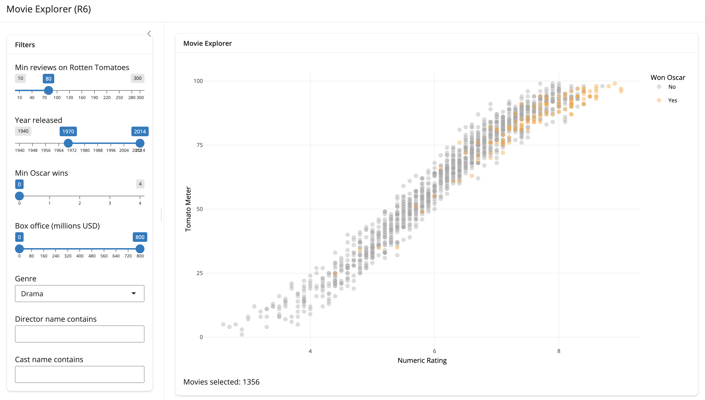

# `movexplR6`

The goal of `movexplR6` is to demonstrate using [`R6`
objects](https://r6.r-lib.org/index.html) in [Shiny
app-packages](https://mjfrigaard.github.io/shiny-app-pkgs/).

## Installation

You can install the development version of `movexplR6` from
[GitHub](https://github.com/) with:

``` r

# install.packages("pak")
pak::pak("mjfrigaard/movexplR6")
```

Launch:

``` r

library(movexplR6)
launch_app()
```



Check the documentation for more information.
